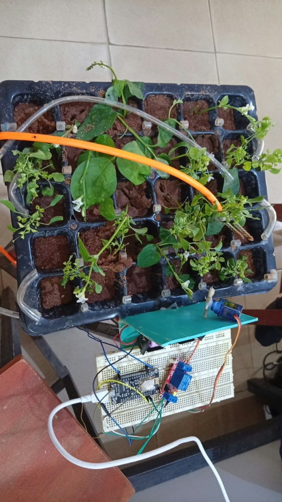
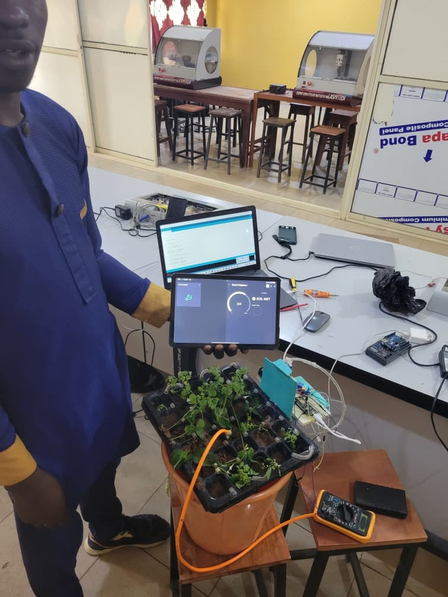
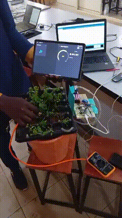
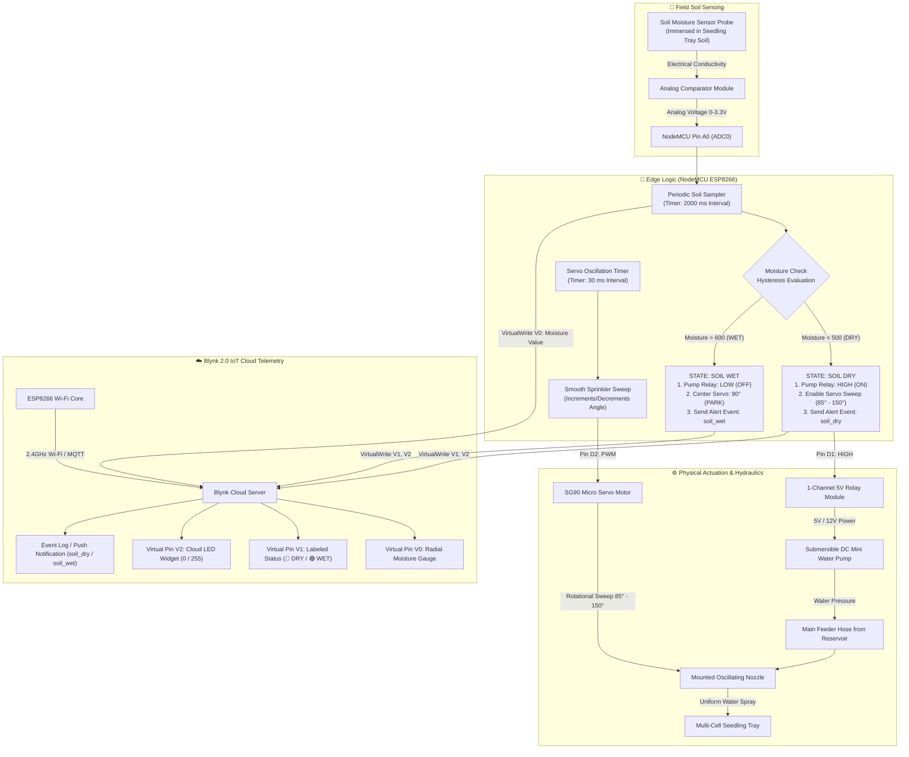

# 🌱 IoT-Based Autonomous Smart Irrigation System (NodeMCU ESP8266 + Blynk IoT)

[](https://www.espressif.com/)
[](https://blynk.io/)
[]()
[]()
[-orange.svg)]()
[](https://en.wikipedia.org/wiki/C%2B%2B)
[](LICENSE)

An intelligent, cloud-connected precision agriculture and automated irrigation system engineered for nurseries, greenhouses, and seedling trays. Powered by a **NodeMCU ESP8266**, the system continuously samples soil volumetric moisture levels, performs closed-loop automated hysteresis control to regulate a **submersible water pump** via a **5V optocoupled relay**, and actively sweeps an **SG90 servo-driven oscillating sprinkler head** across the plant canopy for uniform water dispersal. The entire system streams real-time telemetry to a remote **Blynk IoT** dashboard (web and tablet/mobile), delivering live gauge readouts, status indicators, and event notifications worldwide.

---

## 📸 Project Demonstration & Hardware Showcase

### 1. Physical Hardware & Live Cloud Telemetry
| Physical Circuit & Irrigation Bed | Live Remote Blynk IoT Dashboard |
| :---: | :---: |
|  |  |
| *Multi-cell seedling tray, drip network, NodeMCU ESP8266, 5V relay, and SG90 servo sprinkler nozzle* | *Blynk 2.0 cloud dashboard running on tablet displaying live moisture gauge & telemetry* |

### 2. Live Automated Irrigation in Action
<p align="center">
  
  <br>
  <em><b>Live System Response:</b> Removing the sensor probe from moist soil drops the reading below the 500 threshold, instantly engaging the pump relay, oscillating the SG90 sprinkler nozzle across the plant canopy (85°–150°), and broadcasting a <code>🔴 SOIL DRY</code> alert to the Blynk cloud dashboard.</em>
  <br><br>
  🎬 <a href="assets/system_demonstration.mp4"><strong>Download / Watch High-Definition Demonstration Video (.MP4)</strong></a>
</p>

---

## 🏗️ System Architecture & Dataflow



---

## ⚡ Key Features & Engineering Highlights

1. **Closed-Loop Hysteresis Control**:
   - **Dry Threshold (`< 500`)**: Triggers immediate pump activation and sprinkler oscillation to relieve plant water stress.
   - **Wet Threshold (`> 600`)**: Prevents rapid relay cycling (chattering) by requiring soil to absorb sufficient water before shutting off.
   - Eliminates water waste, prevents root rot, and guarantees stable hydraulic operation.

2. **Oscillating Servo Sprinkler Head**:
   - Rather than relying on a static drip emitter that only wets a single spot, the system mounts a water nozzle to an **SG90 micro servo**.
   - Sweeps continuously across an **$85^\circ$ to $150^\circ$ arc** at 30ms non-blocking increments while watering, ensuring uniform moisture coverage across multi-cell seedling trays.
   - Automatically parks at center ($90^\circ$) when irrigation terminates.

3. **Non-Blocking Timer Architecture**:
   - Built on `BlynkTimer` rather than blocking `delay()` functions.
   - Soil moisture is sampled deterministically every **2,000 ms** (`checkSoil`).
   - The servo angular step is executed every **30 ms** (`moveSprinkler`).
   - Keeps the ESP8266 background Wi-Fi and Blynk heartbeat loops fully responsive without watchdog timer (WDT) resets.

4. **Real-Time IoT Remote Telemetry**:
   - Access and supervise crop moisture conditions from anywhere via tablet, smartphone (iOS/Android), or web dashboard.
   - Instant push alerts and cloud event logs when soil drops below optimal moisture levels.

---

## 🔌 Hardware Circuit Pinout & Wiring

| Component | Component Pin | NodeMCU Pin | GPIO | Function / Electrical Notes |
| :--- | :--- | :--- | :--- | :--- |
| **Soil Moisture Sensor** | **AOUT (Analog)** | **A0** | ADC0 | Analog voltage proportional to volumetric moisture (0–1.0V internal / 0–3.3V module divider) |
| **Soil Moisture Sensor** | **VCC** | **3V3** | — | Powered from NodeMCU 3.3V rail to prevent rapid galvanic corrosion |
| **Soil Moisture Sensor** | **GND** | **GND** | — | Ground reference |
| **1-Channel Relay** | **IN (Signal)** | **D1** | GPIO5 | Active HIGH / LOW relay coil drive |
| **1-Channel Relay** | **VCC** | **VIN / 5V** | — | +5V DC power for relay coil |
| **1-Channel Relay** | **GND** | **GND** | — | Common ground |
| **SG90 Servo Motor** | **PWM (Orange/Yellow)** | **D2** | GPIO4 | 50Hz PWM position signal ($85^\circ - 150^\circ$) |
| **SG90 Servo Motor** | **VCC (Red)** | **VIN / 5V** | — | +5V DC supply (high-current rail) |
| **SG90 Servo Motor** | **GND (Brown/Black)** | **GND** | — | Common ground |
| **Submersible Pump** | **Positive (+)** | **Relay NO** | — | Switched through Relay Normally Open terminal |
| **Submersible Pump** | **Negative (-)** | **Power GND** | — | Return to power source ground |
| **Relay Switch Common** | **COM Terminal** | **+5V / +12V**| — | External DC power rail for pump |

> ⚠️ **IMPORTANT POWER NOTE:** Do not attempt to drive the submersible water pump directly from the NodeMCU onboard 3.3V or 5V regulator. Connect the pump power supply through the relay's `COM` and `NO` (Normally Open) terminals with common ground established between the microcontroller and pump power source.

---

## 🛠️ Complete Bill of Materials (BOM) & Pricing

### Pricing in Nigerian Naira (₦ NGN) & US Dollars ($ USD)

| Item | Component | Specification | Role in System | Qty | Est. Cost (₦ NGN) | Est. Cost ($ USD) |
| :---: | :--- | :--- | :--- | :---: | :---: | :---: |
| **1** | **NodeMCU ESP8266** | ESP-12E / CP2102 Wi-Fi Development Board | Edge controller & IoT Wi-Fi gateway | 1 | ₦5,500 – ₦8,500 | $3.50 – $5.50 |
| **2** | **Soil Moisture Sensor** | Resistive / Capacitive sensor with LM393 | Analog soil water detection | 1 | ₦1,500 – ₦3,000 | $1.00 – $2.00 |
| **3** | **1-Channel Relay Module**| 5V DC coil, optocoupler-isolated (10A 250VAC) | Safe inductive pump isolation | 1 | ₦1,800 – ₦3,000 | $1.20 – $2.00 |
| **4** | **Submersible Mini Pump**| 3V–6V DC or 12V DC mini water pump (120L/h) | Pressurized irrigation delivery | 1 | ₦3,500 – ₦6,000 | $2.30 – $4.00 |
| **5** | **SG90 Micro Servo** | 9g nylon-gear analog micro servo motor | Oscillating nozzle actuator | 1 | ₦2,200 – ₦4,000 | $1.50 – $2.60 |
| **6** | **Irrigation Tubing Kit** | Flexible PVC / silicone tubing + spray tip | Water transport & spray delivery | 1 set | ₦2,000 – ₦4,500 | $1.30 – $3.00 |
| **7** | **Acrylic / 3D Mount** | Rigid mounting bracket for servo nozzle | Mechanical support stand | 1 | ₦1,500 – ₦3,000 | $1.00 – $2.00 |
| **8** | **Seedling Planter Tray**| Multi-cell propagation seedling flat | Cultivation bed | 1 | ₦2,000 – ₦4,000 | $1.30 – $2.60 |
| **9** | **Water Reservoir** | 2L – 5L plastic bucket or basin | Water storage reservoir | 1 | ₦1,500 – ₦3,000 | $1.00 – $2.00 |
| **10** | **Prototyping Kit** | 400-tie point breadboard + Dupont jumpers | Electrical interconnects | 1 set | ₦2,500 – ₦4,500 | $1.60 – $3.00 |
| **11** | **5V Power Supply** | 5V 2A micro-USB adapter or battery bank | System power | 1 | ₦3,000 – ₦5,500 | $2.00 – $3.60 |
| **TOTAL**| **Complete IoT System** | **Complete Precision Agriculture Turnkey Kit** | **All items included** | — | **₦26,500 – ₦49,000** | **$19.70 – $32.30** |

---

## 🌐 Blynk 2.0 Cloud Platform Configuration

The firmware [`irigation_system_IoT.ino`](irigation_system_IoT.ino) uses Blynk 2.0. To set up your cloud template:

### 1. Template Setup
- **Template ID**: `TMPL2oNxElFgv`
- **Template Name**: `Smart Irrigation`
- **Hardware**: `ESP8266`
- **Connection Type**: `WiFi`

### 2. Datastream Definitions

| Datastream Name | Pin | Data Type | Min | Max | Default | Role |
| :--- | :---: | :---: | :---: | :---: | :---: | :--- |
| **Soil Moisture** | `V0` | Integer | `0` | `1023` | `0` | Real-time analog moisture readout |
| **Irrigation Status** | `V1` | String | — | — | `"INITIALIZING"` | Status display (`"🔴 SOIL DRY"` / `"🟢 SOIL WET"`) |
| **Alert Indicator** | `V2` | Integer | `0` | `255` | `0` | Cloud LED widget (255 = ON/Red, 0 = OFF) |

### 3. Events & Notifications
Under the **Events** tab in the Blynk console, register:
- **Event Name:** `Soil Moisture Low`
  - **Event Code:** `soil_dry`
  - **Type:** `Warning`
  - **Description:** `"Soil moisture is low. Irrigation has started."`
- **Event Name:** `Soil Moisture Normal`
  - **Event Code:** `soil_wet`
  - **Type:** `Info`
  - **Description:** `"Soil moisture is sufficient. Irrigation has stopped."`

---

## 💻 Software Setup & Installation Guide

### Step 1: Install ESP8266 Board Core in Arduino IDE
1. Open the **Arduino IDE**.
2. Navigate to **File > Preferences**.
3. In the **Additional Boards Manager URLs** field, paste:
   ```
   http://arduino.esp8266.com/stable/package_esp8266com_index.json
   ```
4. Go to **Tools > Board > Boards Manager...**, search for `esp8266`, and install **esp8266 by ESP8266 Community**.

### Step 2: Install Required Libraries
Open **Sketch > Include Library > Manage Libraries...** and install:
- **`Blynk`** by *Volodymyr Shymanskyy* (v1.3.x or higher)
- **`Servo`** (built-in with ESP8266 core)

### Step 3: Configure Credentials in `irigation_system_IoT.ino`
Update lines 1–11 with your specific network and cloud credentials:

```cpp
#define BLYNK_TEMPLATE_ID "TMPL2oNxElFgv"
#define BLYNK_TEMPLATE_NAME "Smart Irrigation"
#define BLYNK_AUTH_TOKEN "YOUR_BLYNK_AUTH_TOKEN"

// Wi-Fi Credentials
char ssid[] = "YOUR_WIFI_SSID";
char pass[] = "YOUR_WIFI_PASSWORD";
```

### Step 4: Flash the NodeMCU
1. Connect the NodeMCU to your computer via micro-USB.
2. Under **Tools > Board**, select **NodeMCU 1.0 (ESP-12E Module)**.
3. Select the appropriate **Port**.
4. Set **Upload Speed** to `115200`.
5. Click **Upload** (`Ctrl+U`).
6. Open the **Serial Monitor** at `115200 baud` to verify Wi-Fi connection and live telemetry.

---

## 🧪 Calibration & Field Testing

1. **Air / Dry Soil Calibration**:
   - Hold the sensor probe in open air or bone-dry soil. The analog reading on `A0` typically reads `< 500`.
   - The Serial Monitor will print `SOIL DRY - PUMP ON`.
   - The relay triggers, the pump starts discharging water, and the servo begins its $85^\circ - 150^\circ$ sweep.
   - The Blynk app displays `🔴 SOIL DRY`, the virtual LED lights up, and a push alert is generated.
2. **Moisture Saturation Calibration**:
   - Submerge the sensor probe into moist soil or a cup of water.
   - The analog reading on `A0` rises above `600`.
   - The Serial Monitor will print `SOIL WET - PUMP OFF`.
   - The relay de-energizes, the pump stops, and the servo returns to its center home position ($90^\circ$).
   - The Blynk app displays `🟢 SOIL WET` and turns off the alert indicator.

---

## 📁 Repository Structure

```
IoT-Based-Smart-Irrigation-System/
├── irigation_system_IoT.ino    # Native Arduino firmware for NodeMCU ESP8266
└── README.md                   # Comprehensive engineering documentation
```

---

## 📜 License

This project is licensed under the [MIT License](LICENSE).
